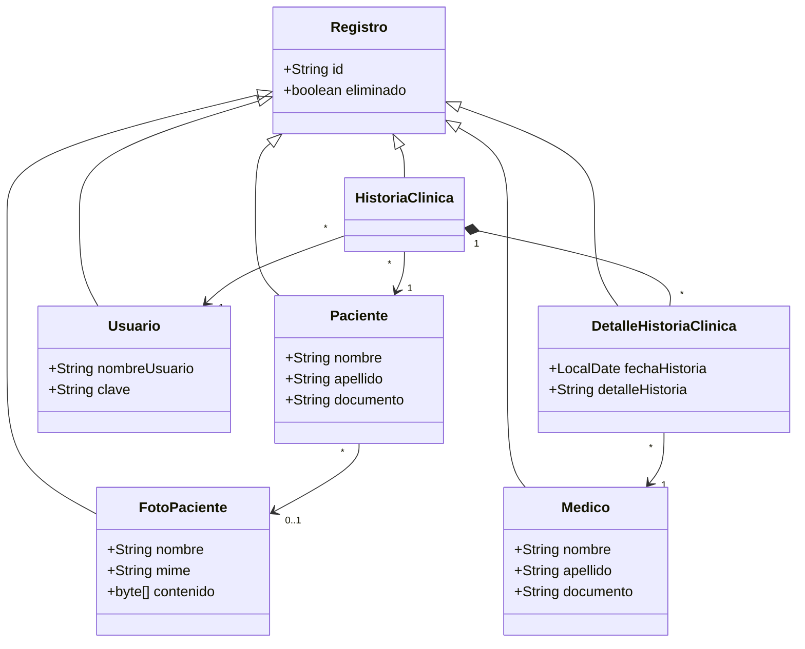
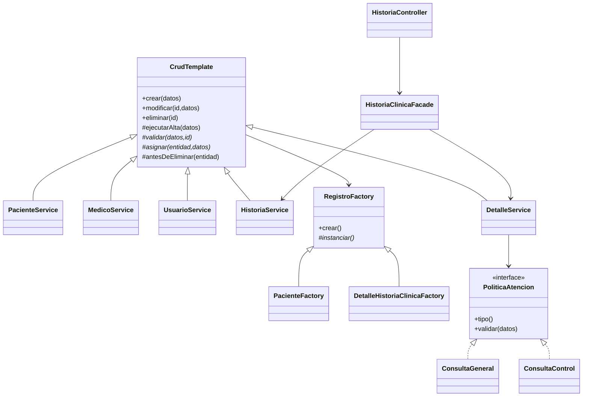

# Fundamentación y refactorización

## 1. Template Method: patrón solicitado en la solución inicial

**Concepto teórico.** Es un patrón de comportamiento que define el esqueleto de un algoritmo en una superclase y permite redefinir pasos concretos en las subclases. La secuencia permanece estable; cambian las operaciones primitivas y los hooks opcionales. Reutiliza código mediante herencia y aplica inversión de control: la superclase llama a los pasos de la subclase.

**Problema del ejercicio.** Paciente, médico, usuario, historia y detalle requieren validar, instanciar, asignar datos y persistir; al modificar se debe buscar un registro activo antes de validarlo, y una baja debe respetar reglas de referencias. Copiar esa secuencia en cada servicio favorece omitir validaciones o borrar físicamente una clase y lógicamente otra.

**Aplicación concreta.** `CrudTemplate<T,R>` fija tres algoritmos protegidos `final`:

```java
protected final T ejecutarAlta(R datos) {
    validar(datos, null);
    T entidad = factory.crear();
    asignar(entidad, datos);
    em.persist(entidad);
    return entidad;
}
```

- `ejecutarModificacion`: buscar activo → validar → asignar; JPA detecta los cambios dentro de la transacción.
- `ejecutarBaja`: buscar activo → `antesDeEliminar` → marcar `eliminado=true`.
- Operaciones primitivas obligatorias: `validar` y `asignar`.
- Hook opcional: `antesDeEliminar`, vacío por defecto. `HistoriaService` lo implementa para dar de baja sus detalles; los servicios de personas y usuarios lo usan para proteger referencias activas.
- Clases concretas: `PacienteService`, `MedicoService`, `UsuarioService`, `HistoriaService`, `DetalleService`.

Los métodos públicos `crear`, `modificar` y `eliminar` delegan en esos algoritmos. Se dejan interceptables para que el proxy transaccional de Spring abra la transacción; declarar `final` esos puntos públicos impediría la intercepción de CGLIB. Los algoritmos que fijan la secuencia sí son `final`.

**Ejemplo de ejecución.** Al crear un paciente, la plantilla llama a `PacienteService.validar` para reservar un documento único, utiliza el creador, normaliza nombre/apellido/documento en `asignar` y persiste. Al crear una atención usa el mismo orden, pero verifica historia, médico y política de atención. Si una validación falla no se ejecuta la persistencia.

**Costo.** Hay acoplamiento por herencia y la secuencia es deliberadamente rígida. Por eso no se agregan condicionales de tipo de atención al template; esa variación se extrae con Strategy.

## 2. Propuesta creacional: Factory Method

**Concepto teórico.** Define una operación de creación en una clase creadora y permite a subclases decidir la clase concreta del producto. El cliente depende de la abstracción de creación, sin construir directamente el producto concreto en su algoritmo.

**Antes de la refactorización (fragmento ilustrativo).** Cada servicio tenía que construir e inicializar la entidad antes de persistir:

```java
Paciente paciente = new Paciente();
paciente.id = UUID.randomUUID().toString();
paciente.eliminado = false;
```

El código repetía la generación de identidad y el estado inicial, y el flujo de alta conocía el constructor del producto. Los fragmentos “antes” de este documento explican la transformación; los módulos ejecutables contienen la implementación final refactorizada.

**Después.** `RegistroFactory<T>` declara el Factory Method abstracto `instanciar()`. Su operación `crear()` llama a ese método, asigna un UUID y establece `eliminado=false`. `PacienteFactory`, `MedicoFactory`, `UsuarioFactory`, `HistoriaClinicaFactory`, `DetalleHistoriaClinicaFactory` y `FotoPacienteFactory` implementan `instanciar()`.

```java
public class PacienteFactory extends RegistroFactory<Paciente> {
    protected Paciente instanciar() { return new Paciente(); }
}
```

**Participantes.** Producto base: `Registro`. Productos concretos: las seis entidades. Creador: `RegistroFactory`. Creadores concretos: las seis fábricas. Cliente: `CrudTemplate` y, para imágenes, `FotoService`. La inyección de dependencias entrega la fábrica concreta a cada servicio.

**Justificación.** Centraliza las invariantes de creación y permite introducir productos especializados sin modificar el algoritmo de ABM. Se eligió Factory Method explícito, con creador abstracto y subclases, en lugar de llamar “Factory Method” a un simple método estático o a un `switch` de constructores. No crea entidades incompletas en la base: las asociaciones obligatorias se asignan antes de `persist`.

**Costo.** Agrega varias clases pequeñas. En una aplicación sin fines pedagógicos, la construcción de entidades tan simples podría resolverse con constructores; aquí hace visible y verificable la extensión creacional solicitada.

## 3. Propuesta de comportamiento: Strategy

**Concepto teórico.** Encapsula una familia de algoritmos tras una interfaz común y permite elegirlos por composición en tiempo de ejecución. El contexto delega el comportamiento a una estrategia intercambiable.

**Antes de la refactorización.** La variación clínica podía terminar dentro de la validación del servicio:

```java
if (tipo.equals("GENERAL")) { /* exigir descripción de 10 caracteres */ }
else if (tipo.equals("CONTROL")) { /* exigir evolución de 20 caracteres */ }
```

Agregar otra modalidad obligaría a modificar esa cadena y mezclaría reglas específicas con la secuencia de persistencia.

**Después.** `PoliticaAtencion` define `tipo()` y `validar(Detalle)`. `ConsultaGeneral` exige 10 caracteres útiles; `ConsultaControl` exige 20 para la evolución. `DetalleService` recibe `List<PoliticaAtencion>`, selecciona la política por el parámetro `tipo` y delega la validación. Un tipo desconocido produce HTTP 400. Los límites ilustran reglas didácticas del consultorio, no criterios médicos de suficiencia de una historia clínica.

**Participantes.** Estrategia: `PoliticaAtencion`. Estrategias concretas: `ConsultaGeneral` y `ConsultaControl`. Contexto: `DetalleService`. Cliente que selecciona: formularios Java/React o consumidor REST.

**Justificación.** Una nueva modalidad se agrega como otro componente que implementa la interfaz sin alterar el algoritmo de ABM. El algoritmo común se conserva por Template Method; la regla variable se compone por Strategy. Esta Strategy es el patrón de comportamiento **adicional** a Template Method solicitado para la refactorización.

**Costo.** Una interfaz y una clase por modalidad; debe existir una clave de tipo única por estrategia. El tipo es un dato de la operación y no se persiste, preservando los atributos del UML. Al editar una atención se vuelve a seleccionar la política de validación.

## 4. Propuesta estructural: Facade

**Concepto teórico.** Ofrece una interfaz de más alto nivel que simplifica el acceso a un subsistema. Encapsula coordinación y dependencias sin sustituir la lógica interna de sus componentes.

**Antes de la refactorización.** El controlador debía buscar la historia, obtener sus atenciones, contar los resultados y armar la respuesta, repitiendo coordinación en cada consumidor.

```java
var historia = historias.buscar(id);
var atenciones = detalles.deHistoria(id);
// Construir el expediente en el controlador o con varias llamadas del frontend.
```

**Después.** `HistoriaClinicaFacade.consultar(id)` retorna `Expediente(historia, atenciones, totalAtenciones)` dentro de una transacción de lectura. `HistoriaController` delega esa consulta a la fachada y expone `GET /api/historias/{id}`. Ambos frontends reciben el mismo expediente con una sola petición de negocio.

**Participantes.** Fachada: `HistoriaClinicaFacade`. Subsistema: `HistoriaService`, `DetalleService` y las relaciones persistidas. Clientes: `HistoriaController` e indirectamente ambos frontends.

**Justificación.** Mantiene el controlador enfocado en HTTP y evita trasladar el conocimiento de la composición al frontend. Centraliza la consulta agregada y deja el ABM en sus servicios respectivos.

**Costo.** Una abstracción adicional que debe mantenerse acotada a la coordinación del expediente, evitando convertirla en un servicio que concentre todo el sistema.

## 5. Diagramas de la solución final



La foto es opcional para permitir registrar al paciente antes de subirla. La composición se implementa mediante pertenencia obligatoria al crear detalles y baja lógica propagada; no se usa `CascadeType.REMOVE` porque borraría físicamente el historial.



## 6. Cómo comprobar que los patrones participan realmente

1. Crear un paciente y un médico: comparten el algoritmo final de `CrudTemplate`, pero ejecutan sus propios hooks y creadores.
2. Enviar la misma descripción de 15 caracteres como `GENERAL` y `CONTROL`: la primera se acepta y la segunda retorna 400. La prueba `strategyCambiaValidacionSinPersistirFallos` lo verifica.
3. Abrir una historia: `HistoriaController` llama a la fachada; la respuesta contiene historia, atenciones y total, sin contraseñas ni bytes de foto.
4. Dar de baja esa historia: el hook concreto propaga la baja a todos sus detalles dentro de la transacción. El caso `composicionDaDeBajaDetallesEnLaMismaTransaccion` comprueba el estado real en la base.

Los cuatro patrones se implementan en el backend común y por eso se usan en ambas versiones de frontend. No se confunde el template visual Flatly con Template Method: el primero es un recurso de presentación; el segundo organiza un algoritmo de negocio.
